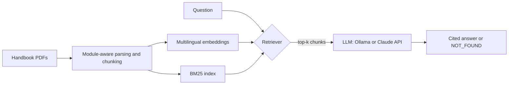

# Module Handbook QA

Ask questions about university study programs and get answers with **cited sources**: credits, prerequisites, exam formats, module coordinators and more. The system answers from official module handbooks and says so when the answer is not in the documents.

It is a retrieval-augmented generation (RAG) project with a focus on **measuring** quality: retrieval strategies are compared on a hand-checked question set, and answers are scored for correctness, faithfulness, citation accuracy and refusal behaviour.

**Corpus:** three real handbooks with three different layouts, parsed into about 900 module-level chunks.

| Handbook | Program | Chunks |
|---|---|---|
| KIT | Computer Science (M.Sc.), SPO 2025 | 641 |
| TU Dortmund | Data Science (M.Sc.), updated Nov 2022 | 86 |
| TU Braunschweig | Data Science (M.Sc.), PO 2, SS 2026 | 185 |

## How it works



1. **Ingestion (`src/ingest.py`)**: each handbook has its own parser. Text is split at module boundaries first, so facts such as "5 CP" or "prerequisites" stay attached to the right module. Long modules are sub-split with overlap. Every chunk carries a context header (university, program, module name and ID) plus metadata (pages, kind).
2. **Indexing (`src/index.py`)**: chunks are embedded with `intfloat/multilingual-e5-base`, so questions and documents can be in different languages.
3. **Retrieval (`src/retrieve.py`)**: three strategies: BM25 (keywords), dense (embedding similarity) and hybrid (Reciprocal Rank Fusion of both), with an optional filter by university.
4. **Generation (`src/generate.py`, `src/llm.py`)**: the model answers only from the retrieved passages, cites them as `[1]`, `[2]`, and replies `NOT_FOUND` when the context does not contain the answer. The backend is switchable: local models through Ollama, or the Claude API.
5. **Evaluation (`eval/`)**: a 33-question gold set and scripts for retrieval and answer-quality metrics.

## Evaluation

### Gold set
33 questions, each with a gold answer and the module(s) that contain it, written from the handbook text: single-fact (17), native-language (7), cross-lingual (1), multi-module (3) and **unanswerable (5)**, which test whether the system refuses instead of guessing.

### Retrieval results (28 answerable questions)

| Strategy | Hit@1 | Hit@3 | Hit@5 | Recall@5 | MRR |
|---|---|---|---|---|---|
| BM25 | 0.571 | 0.893 | 0.893 | 0.875 | 0.724 |
| Dense | **0.893** | **0.964** | **0.964** | 0.917 | **0.932** |
| Hybrid (RRF) | 0.857 | 0.929 | **0.964** | **0.946** | 0.894 |

*Hit@k: a correct module appears in the top-k chunks. Recall@k: share of the required modules found (matters for multi-module questions). MRR: mean reciprocal rank of the first correct chunk.*

**Findings**
- Dense retrieval clearly beats keyword-only BM25, mostly because it handles the cross-lingual question that BM25 misses entirely.
- Dense and hybrid are close. The gap is one or two questions out of 28, which is within noise at this sample size, so no claim is made that one beats the other. Hybrid has the best Recall@5.
- **Remaining failure (all strategies):** "Which modules are taught only in one language?" needs the overview table of a handbook, not any single module page. This is a known weakness of chunk-based RAG on aggregation questions.
- Hybrid failed the cross-lingual question that dense answered, because the keyword half pulled in wrong chunks. Keyword matching does not help across languages.

### Answer quality

<!-- TODO: fill in after running: python -m eval.answer_eval --backend <ollama|anthropic> --tag <name> -->

| Generator | Retrieval hit | Citation hit | Correctness | Faithfulness | False refusals | Correct refusals |
|---|---|---|---|---|---|---|
| *(run pending)* | | | | | | |

Metrics are computed by `eval/answer_eval.py`: correctness and faithfulness are judged by an LLM, citation hit checks that the cited passages include the gold module, and refusal metrics use the 5 unanswerable questions.

## Design decisions and lessons

- **Module-aware chunking instead of fixed-size windows.** Handbooks are tables of facts per module. Fixed windows cut across module boundaries and mix up credits and prerequisites.
- **One parser per handbook.** Header formats differ (`[M-INFO-106608]` at KIT, `MD E1-2` at TU Dortmund, a two-line `Modulname` label at TU Braunschweig).
- **Bug found through evaluation.** The first index attributed 200+ pages of KIT's separate "module components" section to one module. Splitting these into their own units, removing table-of-contents lines and isolating Dortmund's elective-section notes fixed the leakage. Total chunks went from 916 to 912.
- **Context header on every chunk** so a retrieved passage always states which university and module it belongs to.

## Limitations

- The gold set is small (33 questions) and was drafted by the author from the handbook text, so confidence intervals are wide.
- LLM judges are imperfect, especially small local models. A sample of judged answers should be checked by hand.
- No reranker yet, and aggregation questions across a whole handbook are not solved.
- Handbooks are snapshots of specific semesters and change over time.

## Setup

```bash
git clone https://github.com/arpiitaaa/module-handbook-qa.git
cd module-handbook-qa
python -m venv .venv
# Windows: .venv\Scripts\Activate.ps1      macOS/Linux: source .venv/bin/activate
pip install -r requirements.txt
```

**Data.** The PDFs are not redistributed. Download them into `data/raw/` and keep the file names:

| File name | Source |
|---|---|
| `88-979-H-2025_v1_2025-10-14_en.pdf` | https://www.informatik.kit.edu/downloads/stud/88-979-H-2025_v1_2025-10-14_en.pdf |
| `ModHb_MSc_DaSc_2022.pdf` | https://statistik.tu-dortmund.de/storages/statistik/r/Downloads/Studium/Studiengaenge-Infos/ModHb_MSc_DaSc_2022.pdf |
| `Modulhandbuch_DataScience_PO2_SS26_de.pdf` | https://www.tu-braunschweig.de/fileadmin/Redaktionsgruppen/Fakultaeten/FK1/Data_Science/Modulhandbuch_DataScience_PO2_SS26_de.pdf |

(Universities may move or update these files; if a link breaks, search the title on the university site.)

## Usage

```bash
python -m src.ingest                 # parse PDFs -> data/processed/chunks.jsonl
python -m src.index                  # embed chunks (first run downloads ~1 GB model)
python -m src.retrieve "Which modules cover reinforcement learning?" --mode hybrid

python -m eval.retrieval_eval        # compare BM25 / dense / hybrid
```

**Generating answers** needs a model. Choose one:

```bash
# Local and free: install Ollama, then
ollama pull llama3.2:3b
python -m src.generate "How many credits is the Master's Thesis at KIT?" --backend ollama

# Claude API: put ANTHROPIC_API_KEY=... in a .env file (git-ignored), then
python -m src.generate "How many credits is the Master's Thesis at KIT?" --backend anthropic

# Full answer-quality evaluation
python -m eval.answer_eval --backend ollama --tag llama32-3b
```

## Project structure

```
src/
  ingest.py      per-handbook parsing and module-aware chunking
  index.py       embeddings
  retrieve.py    BM25 / dense / hybrid retrieval
  llm.py         Ollama and Claude API backends
  generate.py    RAG answer with citations and NOT_FOUND handling
eval/
  questions.jsonl      33-question gold set
  retrieval_eval.py    Hit@k, Recall@k, MRR
  answer_eval.py       correctness, faithfulness, citation and refusal metrics
results/               evaluation outputs
```

## Tech stack

Python, PyMuPDF, sentence-transformers (`multilingual-e5-base`), rank-bm25, NumPy, Ollama / Claude API.

## Disclaimer

The handbook documents belong to their universities. This project is an independent study tool; answers may be outdated or wrong, so always check the official documents.
